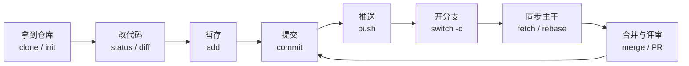
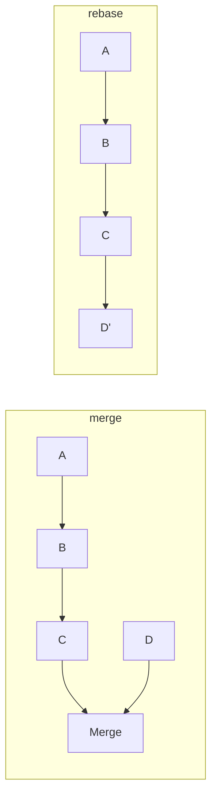

---
title: "Git 指令系统整理"
date: 2026-11-09 14:10:00 +0800
categories: [教程, 工具]
tags: [git]
description: 把 Git 常用指令串成一套能直接照着用的操作手册。
mermaid: true
---

> 这篇文章不打算把 `git --help` 抄一遍。Git 有两百多个子命令，真正决定你效率的其实是：**在什么场景下，知道该用哪几条，以及为什么用这条而不是那条**。下面按开发时间线组织，每一节都是一个能对上号的真实场景。
> {: .prompt-info }

## 场景地图

先给一张全局图。日常 90% 的操作都落在下面这条主线上，其余都是它的分支。



| 你在做什么                         | 主要章节                                         |
| :--------------------------------- | :----------------------------------------------- |
| 新电脑、新项目，先把身份和环境配好 | [一、环境与身份](#一环境与身份)                  |
| 加入一个已有项目 / 从零建仓库      | [二、拿到仓库](#二拿到仓库)                      |
| 每天改代码、提交、推送             | [三、日常循环](#三日常循环)                      |
| 开发新功能、修 bug，需要隔离       | [四、分支](#四分支)                              |
| 把分支合回主干，保持历史干净       | [五、合并与变基](#五合并与变基)                  |
| 冲突了、提交写错了、代码删没了     | [六~八、冲突 / 撤销 / 找回](#六冲突处理)         |
| 多人协作、PR、发布版本             | [十~十一、远程 / 发布 / 协作](#十远程与多人协作) |

## 一、环境与身份

### 场景：刚装好 Git，第一件事做什么

Git 会把「谁提交的」写进每一个 commit，所以先配身份，再谈其他。配置分三级，**优先级从低到高**：`system`（整台机器）< `global`（当前用户）< `local`（当前仓库）。

```bash
# 必配：提交署名（写错名字，历史里很难看）
git config --global user.name "Haozhi Tang"
git config --global user.email "tanghaozhi@aliyun.com"

# 强烈建议：默认分支名、换行符、中文文件名显示
git config --global init.defaultBranch main
git config --global core.autocrlf input     # Windows 上避免 CRLF 污染仓库
git config --global core.quotepath false    # 让 git status 正常显示中文名

# 查看当前生效的配置（含来源文件）
git config --list --show-origin
```

> Windows 上 `core.autocrlf` 设成 `input`，提交时把 CRLF 转成 LF，检出时不转换。团队里有人用 Windows、有人用 macOS 时，这一步能省掉大量「整个文件都变了」的假 diff。
> {: .prompt-tip }

### 场景：命令太长，想少敲几个字

别名只影响你自己，不影响仓库，可以放心加。下面这套是社区里比较通用的组合：

```bash
git config --global alias.st  status
git config --global alias.co  checkout
git config --global alias.br  branch
git config --global alias.ci  commit
git config --global alias.lg  "log --graph --oneline --decorate --all"
git config --global alias.last "log -1 HEAD --stat"
git config --global alias.unstage "reset HEAD --"
```

之后 `git lg` 就能看到带分支图的提交历史，比默认 `git log` 直观得多。

### 场景：不想每次 push 都输密码

推荐 SSH，一次配置长期有效：

```bash
# 1. 生成密钥（一路回车即可，或用 -f 指定路径）
ssh-keygen -t ed25519 -C "tanghaozhi@aliyun.com"

# 2. 把公钥内容贴到 GitHub → Settings → SSH and GPG keys
cat ~/.ssh/id_ed25519.pub

# 3. 验证
ssh -T git@github.com
```

如果公司网络封了 22 端口，可以在 `~/.ssh/config` 里改成走 443：

```text
Host github.com
  HostName ssh.github.com
  Port 443
  User git
```

> 用 HTTPS 克隆的仓库想改成 SSH，不用重新克隆：`git remote set-url origin git@github.com:user/repo.git`。
> {: .prompt-tip }

## 二、拿到仓库

### 场景：参与一个已有项目

```bash
# 最常用：完整克隆
git clone git@github.com:maskhzt/blog.git

# 只要最近一次提交（CI、部署脚本里很省时间）
git clone --depth 1 git@github.com:maskhzt/blog.git

# 只要某个分支
git clone -b dev --single-branch git@github.com:maskhzt/blog.git
```

克隆会自动做三件事：下载对象、创建 `origin` 远程、把默认分支检出到工作区。

### 场景：把本地已有代码交给 Git 管理

```bash
cd my-project
git init
git add .
git commit -m "chore: 初始化项目"
git remote add origin git@github.com:maskhzt/my-project.git
git push -u origin main
```

`-u`（即 `--set-upstream`）只需第一次用，它把本地 `main` 和 `origin/main` 绑定，之后直接 `git push` / `git pull` 就行。

> 建仓库前先写好 `.gitignore`。`node_modules/`、`.env`、`dist/`、`*.log` 这些一旦提交进去，后面清理要重写历史，很麻烦。
> {: .prompt-warning }

### 场景：仓库里既有大文件又有历史，克隆太慢

```bash
# 只拉元数据，按需检出（适合超大仓库）
git clone --filter=blob:none git@github.com:org/big-repo.git

# 看仓库到底有多大、谁占的空间
git count-objects -vH
```

## 三、日常循环

### 场景：改完代码，准备提交

这是最高频的一条链路，建议形成肌肉记忆：**看状态 → 看差异 → 精确暂存 → 写清楚提交信息**。

```bash
git status                 # 哪些改了、哪些已暂存、在哪个分支
git status -s              # 紧凑模式，一行一个文件

git diff                   # 工作区 vs 暂存区（还没 add 的改动）
git diff --staged          # 暂存区 vs 最后一次提交（即将提交的内容）
git diff HEAD              # 工作区 + 暂存区 vs 最后一次提交（全部改动）

git add src/login.ts       # 精确暂存单个文件
git add src/               # 暂存整个目录
git add -p                 # 交互式逐块暂存（把无关修改拆出去）

git commit -m "feat(login): 支持手机号验证码登录"
```

`git add -p` 是被低估的命令：一次改动里往往混着「功能」和「顺手改的格式」，用它把每个 hunk 单独决定要不要进这次提交，提交历史会干净很多。

### 场景：提交信息怎么写才不乱

约定式提交（Conventional Commits）是目前最通用的写法，格式是 `type(scope): subject`：

```text
feat(auth): 增加短信验证码登录
fix(api): 修正分页参数越界导致 500
docs: 补充本地启动说明
refactor(order): 拆出金额计算函数，行为不变
test(cart): 补充分类满减的边界用例
chore(deps): 升级 vite 到 5.x
```

| 前缀                      | 含义                            | 会不会进 CHANGELOG |
| :------------------------ | :------------------------------ | :----------------: |
| `feat`                    | 新功能                          |         会         |
| `fix`                     | 修 bug                          |         会         |
| `perf`                    | 性能优化                        |         会         |
| `refactor`                | 重构，行为不变                  |      一般不会      |
| `docs` / `test` / `chore` | 文档、测试、杂务                |        不会        |
| `BREAKING CHANGE`         | 不兼容变更（写在正文或 `!` 后） |   会，且显著标出   |

> 提交信息第一行控制在 50 字符内、用祈使句、结尾不加句号。半年后 `git log --oneline` 是你唯一的线索来源。
> {: .prompt-tip }

### 场景：提交完发现漏了一个文件

```bash
git add forgotten.ts
git commit --amend --no-edit     # 并进上一次提交，不改提交信息
```

> `--amend` 会**改写提交**，生成新的 commit hash。只对「还没推送」的提交这么做；已经推到共享分支上的提交，改完再推会需要强推，影响别人。
> {: .prompt-warning }

### 场景：想看这个文件每一行是谁、为什么改的

```bash
git log --oneline -- src/login.ts     # 这个文件的提交历史
git log -p -- src/login.ts            # 连具体改动一起看
git blame src/login.ts                # 逐行标注作者与提交
git blame -L 40,60 src/login.ts       # 只看 40~60 行
```

`blame` 看到可疑行后，拿 commit hash 去 `git show <hash>`，基本就能还原当时的上下文。

## 四、分支

### 场景：要开发新功能，不能直接改 main

```bash
git switch main              # 先回到主干
git pull                     # 确保是最新
git switch -c feat/login     # 从当前 HEAD 新建并切过去

# 等价的老写法（Git 2.23 之前）
git checkout -b feat/login
```

`switch` / `restore` 是 Git 2.23 引入的拆分命令：`switch` 只管切分支，`restore` 只管恢复文件。它们的语义比一把梭的 `checkout` 清楚，新项目建议直接用新命令。

### 场景：分支命名怎么统一

| 类型 | 命名示例            | 说明                                        |
| :--- | :------------------ | :------------------------------------------ |
| 功能 | `feat/user-profile` | 一分支一件事                                |
| 修复 | `fix/order-timeout` | 最好带上 issue 号：`fix/1234-order-timeout` |
| 发布 | `release/1.4.0`     | 只做版本收尾，不再加功能                    |
| 热修 | `hotfix/login-500`  | 从线上 tag 拉出，修完同时回合主干           |
| 实验 | `exp/new-editor`    | 明确「可能丢弃」，不合并也无所谓            |

### 场景：常用的分支操作

```bash
git branch                   # 本地分支
git branch -a                # 含远程分支
git branch -vv               # 含上游跟踪关系与领先/落后数

git branch -m old new        # 重命名
git branch -d feat/login     # 删除已合并分支（安全）
git branch -D feat/login     # 强制删除（有未合并提交时）

git push origin --delete feat/login   # 删除远程分支
```

`git branch -vv` 的输出里，`[origin/main: ahead 2, behind 1]` 这种标记非常有用：说明本地领先 2 个提交、落后 1 个，该 push 还是该 pull 一目了然。

### 场景：主干更新了，我的分支还停在三天前

推荐用 `rebase` 把自己的提交「搬到」最新主干之上，历史是一条直线：

```bash
git fetch origin
git rebase origin/main
```

如果这个分支已经推给别人、别人也在上面提交，就用 `merge` 代替，别改写公共历史：

```bash
git merge origin/main
```

> 选 `rebase` 还是 `merge` 的分界线：**这个分支只有我一个人在用吗？** 是 → 可以 rebase；否 → 用 merge。
> {: .prompt-info }

## 五、合并与变基

### 场景：功能做完了，合回主干

```bash
git switch main
git pull
git merge --no-ff feat/login    # 保留一条合并记录，能看出「这是一个功能分支」
```

`--no-ff` 会强制生成 merge commit，好处是分支边界清晰；不加则是 fast-forward，历史是一条直线但看不出分支曾经存在。团队约定统一即可。

### 场景：merge 和 rebase 到底差在哪



| 维度         | `merge`                    | `rebase`                   |
| :----------- | :------------------------- | :------------------------- |
| 历史形态     | 分叉后汇合，保留真实时间线 | 一条直线，像从未分叉       |
| 是否改写提交 | 否                         | 是，commit hash 全变       |
| 冲突解决次数 | 一次解决完                 | 可能每个提交都要解一次     |
| 适合场景     | 公共分支、长期分支合并     | 个人分支同步主干、提交整理 |
| 风险         | 历史图较乱                 | 对已推送分支使用会坑队友   |

> **黄金规则：不要 rebase 已经推送到共享分支上的提交。** 别人基于旧 hash 的工作会被打乱，下一次 pull 就是一堆冲突。
> {: .prompt-danger }

### 场景：提交太碎，想合并成一条再合并

```bash
# 方式一：交互式变基，把最近 3 个提交压成一个
git rebase -i HEAD~3
# 编辑器里把后两条的 pick 改成 squash（或 s），保存退出

# 方式二：软重置后重新提交
git reset --soft HEAD~3
git commit -m "feat(login): 完整的登录模块"
```

### 场景：只想把某个提交摘到当前分支

```bash
git cherry-pick a1b2c3d              # 摘单个
git cherry-pick a1b2c3d e4f5a6b      # 摘多个
git cherry-pick a1b2c3d..e4f5a6b     # 摘一个区间（左开右闭）
```

典型用途：在 `main` 上修好的 bug，要同步到 `release/1.4` 分支，而两个分支差异很大、不能整体 merge。

## 六、冲突处理

### 场景：merge / rebase / pull 时提示冲突

冲突不可怕，本质就是「Git 不知道这两行该留哪个，你来定」。标准流程：

```bash
git status                      # 看哪些文件是 "both modified"
# 打开文件，会看到 <<<<<<< ======= >>>>>>> 三段标记，手工改成想要的结果

git add src/login.ts            # 标记为已解决（注意：不是 git commit）
git merge --continue            # 或 git rebase --continue
```

冲突标记长这样，中间那行是分隔线，上下分别是两个分支的内容：

```text
<<<<<<< HEAD
const timeout = 3000;
=======
const timeout = 5000;
>>>>>>> feat/login
```

### 场景：改乱了，想放弃这次合并

```bash
git merge --abort       # 回到合并前
git rebase --abort      # 回到变基前
git cherry-pick --abort # 回到摘取前
```

> 三方合并中途放弃是安全的，`--abort` 会把工作区恢复到操作前的状态。前提是冲突文件里没有你手动改到一半、又没提交的内容。
> {: .prompt-tip }

### 场景：不想手工解，想直接用某一方的版本

```bash
git checkout --ours   src/login.ts     # 保留当前分支版本
git checkout --theirs src/login.ts     # 保留对方版本
git add src/login.ts
```

方位要分清：`merge` 时 `--ours` 是你当前所在的分支，`--theirs` 是被合进来的分支；`rebase` 时 Git 会先切到上游，所以 `--ours` 是**上游分支**，`--theirs` 才是你自己正在被搬过去的提交。换句话说，「ours 永远指已检出的那一侧」，只是 rebase 过程中被检出的是上游，方向看着就像反了。拿不准时用 `git status` 看提示，别凭感觉。

### 场景：配一个好用的合并工具

```bash
git config --global merge.tool vscode
git config --global mergetool.vscode.cmd "code --wait --merge \$REMOTE \$LOCAL \$BASE \$MERGED"
git mergetool
```

## 七、撤销：改错了怎么办

这一节是 Git 事故的高发区。先记住一张「改动在哪个位置」的图，再对照表选命令。

```text
工作区(Working)  --add-->  暂存区(Index)  --commit-->  本地仓库(HEAD)  --push-->  远程
   discard/restore            unstage/reset              amend/reset                revert
```

### 场景速查：改动到哪一步，用什么撤

| 想撤销什么             | 命令                        |      会不会丢代码      |
| :--------------------- | :-------------------------- | :--------------------: |
| 工作区某个文件的修改   | `git restore file`          |  会，未保存的改动消失  |
| 工作区全部修改         | `git restore .`             |           会           |
| 已 `add`，想撤回暂存   | `git restore --staged file` |  不会，改动还在工作区  |
| 最近一次提交信息写错   | `git commit --amend`        |          不会          |
| 最近一次提交多加了文件 | `git reset --soft HEAD~1`   |  不会，改动回到暂存区  |
| 最近一次提交整个不要了 | `git reset --hard HEAD~1`   |   会，工作区一起重置   |
| 已推送的提交要撤销     | `git revert <hash>`         | 不会，生成一条反向提交 |
| 误删的分支 / 提交      | `git reflog` + `git reset`  |   不会，只要没被 GC    |

### 场景：`git reset` 三种模式怎么选

```bash
git reset --soft  HEAD~1   # 只退 HEAD，改动留在暂存区（想重新提交时用）
git reset --mixed HEAD~1   # 默认模式，改动留在工作区（想重新 add 时用）
git reset --hard  HEAD~1   # 三者全退，改动直接丢弃（危险）
```

> `git reset --hard` 会连同工作区一起重置，未提交的改动直接丢失；它和 `git restore .`、`git clean -fd` 是三个最容易误删代码的命令。执行前先 `git status` 确认没有想留的改动，或者先 `git stash` 兜底。
> {: .prompt-danger }

### 场景：已经 push 了，怎么撤

不要用 `reset` + 强推去改公共历史，用 `revert` 生成一条「反向提交」：

```bash
git revert a1b2c3d              # 撤销某一次提交
git revert HEAD~3..HEAD         # 撤销最近 3 次（会生成 3 条 revert）
git revert -m 1 <merge-hash>    # 撤销一次 merge，-m 1 表示保留第一父提交
```

`revert` 是安全的：历史只增不改，别人 pull 不会有问题。

### 场景：万不得已要强推

只在自己的分支上，且确认没有别人基于它工作时：

```bash
git push --force-with-lease origin feat/login
```

> 用 `--force-with-lease` 而不是 `--force`：前者会在远程有你不知道的新提交时拒绝推送，后者会直接覆盖别人的工作。这一个参数能避免绝大多数「强推把同事代码干掉」的事故。
> {: .prompt-warning }

## 八、找回丢失的代码

### 场景：reset --hard 之后发现删错了

Git 不会立刻销毁对象，`reflog` 记录了 HEAD 的每一次移动。这是最有用、也最容易被忽略的救命命令：

```bash
git reflog                      # 看最近所有 HEAD 变化
# 找到 "reset: moving to HEAD~1" 之前的那条，比如 a1b2c3d

git reset --hard a1b2c3d        # 回到那个状态
# 或者只把那次的内容捞回来
git cherry-pick a1b2c3d
```

### 场景：误删了一个分支

```bash
git reflog                      # 找到分支最后一次提交的 hash
git switch -c recovered-branch a1b2c3d
```

> reflog 默认保留 90 天；已不可达的对象原则上还会保留 30 天，之后才可能被 `gc` 清掉。只要提交过，基本都能捞回来；从来没 `add` 过的工作区改动，Git 帮不了你。
> {: .prompt-info }

### 场景：想找回某个文件的历史版本

```bash
git log --oneline --all -- path/to/file      # 先找到它存在过的提交
git show a1b2c3d:path/to/file                # 直接看那个版本的内容
git restore --source=a1b2c3d -- path/to/file # 恢复到工作区
```

### 场景：想知道某行代码是哪次提交引入的

```bash
git log -S "timeout = 5000" --oneline        # 按内容搜索提交（pickaxe）
git log -G "timeout\s*=" --oneline           # 按正则搜索
```

## 九、临时保存：stash

### 场景：功能写到一半，突然要切去修线上 bug

```bash
git stash push -m "wip: 登录页样式"   # 存起来，带说明
git stash list                        # 看 stash 栈
git switch hotfix/login-500           # 放心切分支
# 修完回来
git switch feat/login
git stash pop                         # 恢复并删除这条 stash
```

常用变体：

```bash
git stash push -u            # 连未跟踪的新文件一起存（默认不含）
git stash push --keep-index  # 只存未暂存部分，已 add 的留在工作区
git stash apply stash@{1}    # 恢复但保留 stash 记录
git stash drop stash@{1}     # 删除指定记录
git stash clear              # 清空（慎用）
```

> `stash` 是局部的、不进远程的。跨机器同步进度，应该用 WIP 提交推到自己的分支，而不是指望 stash。
> {: .prompt-warning }

## 十、远程与多人协作

### 场景：理清 origin、upstream 这些名字

```bash
git remote -v                       # 看所有远程及其地址
git remote add upstream git@github.com:原项目/repo.git   # fork 场景加原仓库
git remote set-url origin git@github.com:maskhzt/repo.git
git remote remove upstream
git remote show origin              # 看跟踪关系、哪些分支已合并/可清理
```

### 场景：fetch 和 pull 到底有什么区别

```bash
git fetch origin        # 只下载远程更新，不动工作区（安全，可先看再决定）
git pull                # = fetch + merge（或 fetch + rebase，取决于配置）
```

推荐养成「先 fetch 看一眼，再决定 merge 还是 rebase」的习惯：

```bash
git fetch origin
git log --oneline HEAD..origin/main     # 远程比我多了什么
git log --oneline origin/main..HEAD     # 我比远程多了什么
git merge origin/main                   # 确认后再合
```

也可以把 pull 的默认行为固定下来：

```bash
git config --global pull.rebase true    # pull 时用 rebase 而不是 merge
```

### 场景：推送被拒绝（non-fast-forward）

说明远程有你没有的提交。**不要直接 `--force`**，按顺序排查：

```bash
git fetch origin
git log --oneline HEAD..origin/main     # 看远程多了什么
git rebase origin/main                  # 把自己的提交接到远程之上
git push                                # 再推
```

### 场景：Fork 了别人的项目，想同步上游

```bash
git remote add upstream git@github.com:original/repo.git
git fetch upstream
git switch main
git rebase upstream/main
git push origin main
```

### 场景：多人协作时最容易踩的坑

| 现象                          | 原因                   | 处理                                     |
| :---------------------------- | :--------------------- | :--------------------------------------- |
| push 被拒                     | 远程有新提交           | `fetch` 后 `rebase`，再 push             |
| 每次都要输密码                | 用的 HTTPS 且没配凭据  | 换 SSH 或配 credential helper            |
| `git status` 显示一堆莫名改动 | 换行符 / 文件权限变化  | 检查 `core.autocrlf`、`core.fileMode`    |
| 拉下来整个文件都变了          | 编辑器改了行尾或格式化 | 统一 `.editorconfig`，提交前 review diff |
| 提交作者不是自己              | 机器上配了别人的身份   | `git config user.email` 逐仓库修正       |

## 十一、发布与版本

### 场景：给线上版本打标记

```bash
git tag -a v1.4.0 -m "release: 1.4.0"     # 附注标签（推荐，含作者、时间、说明）
git tag v1.4.0                            # 轻量标签（只是个指针）
git tag -l "v1.*"                         # 按模式列出
git show v1.4.0                           # 看标签详情

git push origin v1.4.0                    # 推单个标签
git push origin --tags                    # 推所有标签
git tag -d v1.4.0                         # 删本地
git push origin --delete v1.4.0           # 删远程
```

> `git push` 默认**不会**推标签，发布后记得单独推，否则 CI 拿不到版本号。
> {: .prompt-warning }

### 场景：发布分支怎么管

```bash
git switch -c release/1.4.0 main   # 从主干切发布分支
# 只修 bug、改版本号，不加新功能
git tag -a v1.4.0 -m "release: 1.4.0"
git push origin release/1.4.0 --tags

# 发布后发现紧急问题，从 tag 拉热修分支
git switch -c hotfix/login-500 v1.4.0
# 修完合回 main，并同步到 release 分支
```

### 场景：自动生成更新日志

```bash
git log v1.3.0..v1.4.0 --oneline --no-merges
git shortlog v1.3.0..v1.4.0 -sn          # 按作者统计提交数
git log --pretty=format:"- %s" v1.3.0..v1.4.0 --no-merges
```

如果团队用了约定式提交，这些输出可以直接喂给 `standard-version`、`semantic-release` 之类的工具生成 CHANGELOG。

## 十二、排查问题

### 场景：线上这个 bug 是哪次提交引入的

`bisect` 用二分法定位，比逐个 checkout 快一个数量级：

```bash
git bisect start
git bisect bad                 # 当前版本是坏的
git bisect good v1.3.0         # 这个版本是好的
# Git 会自动切到中间某个提交，你测试后告诉它 good 或 bad
git bisect good                # 或 git bisect bad
# 重复 log2(N) 次后，Git 会指出第一个坏提交
git bisect reset               # 结束，回到原分支
```

可以脚本化，全自动跑：

```bash
git bisect run npm test
```

### 场景：想知道两个分支差在哪

```bash
git log --oneline main..feat/login      # feat 有、main 没有的提交
git log --oneline feat/login..main      # main 有、feat 没有的提交
git diff main...feat/login              # 从分叉点开始的差异（三点）
git diff main..feat/login               # 两个分支当前状态的差异（两点）
```

`...`（三点）和 `..`（两点）的区别值得记：三点是「从共同祖先分叉之后，这个分支做了什么」，做 code review 时通常想要的是三点。

### 场景：工作区莫名其妙很乱

```bash
git status                              # 先看清
git clean -nd                           # 预演：会删哪些未跟踪文件（-n 不实际删）
git clean -fd                           # 确认后再删
git restore .                           # 丢弃所有已跟踪文件的修改
git reset --hard HEAD                   # 彻底回到 HEAD（危险）
```

> `git clean -fd` 会删掉所有未跟踪文件，包括你刚写、还没 `add` 的新文件。**永远先跑 `-n` 预演**。
> {: .prompt-danger }

## 十三、进阶：多工作区与子模块

### 场景：一个仓库要同时改两个分支

不用来回 stash，用 `worktree` 给同一个仓库开多个目录：

```bash
git worktree add ../repo-hotfix hotfix/login-500   # 新目录检出指定分支
git worktree list                                   # 看所有工作区
git worktree remove ../repo-hotfix                  # 用完删掉
```

典型用途：主目录在写功能，临时开一个目录修线上 bug、跑对比测试。

### 场景：项目依赖另一个 Git 仓库

```bash
git submodule add git@github.com:org/lib.git libs/lib
git submodule update --init --recursive   # 克隆后初始化子模块
git submodule update --remote             # 把子模块更新到远程最新

# 或者用 subtree，把外部仓库并进来，使用方无需感知
git subtree add --prefix=libs/lib git@github.com:org/lib.git main --squash
```

| 方案        | 优点                   | 缺点                       |
| :---------- | :--------------------- | :------------------------- |
| `submodule` | 关系明确，各自独立版本 | 协作方要记得 `--recursive` |
| `subtree`   | 使用方无感，克隆即完整 | 同步命令较绕，历史会变长   |

### 场景：只想拉仓库里某一个目录

```bash
git sparse-checkout init --cone
git sparse-checkout set apps/web packages/ui
```

适合超大 monorepo：只检出需要的目录，磁盘和索引都小很多。

## 十四、速查表

按「我想干什么」查，比按字母查快。

| 我想……                   | 命令                                     |
| :----------------------- | :--------------------------------------- |
| 看当前状态               | `git status -s`                          |
| 看未暂存的改动           | `git diff`                               |
| 看已暂存的改动           | `git diff --staged`                      |
| 暂存部分改动             | `git add -p`                             |
| 改上次提交信息           | `git commit --amend`                     |
| 撤销工作区改动           | `git restore <file>`                     |
| 撤销暂存                 | `git restore --staged <file>`            |
| 撤销上次提交（保留改动） | `git reset --soft HEAD~1`                |
| 撤销已推送提交           | `git revert <hash>`                      |
| 找回误删提交             | `git reflog` → `git reset --hard <hash>` |
| 暂存当前进度             | `git stash push -m "说明"`               |
| 恢复暂存进度             | `git stash pop`                          |
| 新建并切换分支           | `git switch -c <branch>`                 |
| 删除已合并分支           | `git branch -d <branch>`                 |
| 同步主干到当前分支       | `git fetch && git rebase origin/main`    |
| 合并分支并保留记录       | `git merge --no-ff <branch>`             |
| 摘取某个提交             | `git cherry-pick <hash>`                 |
| 安全强推                 | `git push --force-with-lease`            |
| 打版本标签               | `git tag -a v1.0.0 -m "release"`         |
| 定位引入 bug 的提交      | `git bisect start`                       |
| 查某行是谁写的           | `git blame -L 40,60 <file>`              |
| 清理未跟踪文件（预演）   | `git clean -nd`                          |

## 十五条保命规则

1. 动手前先 `git status`，清楚自己在哪个分支、有没有未提交改动。
2. 提交前 `git diff --staged` 过一眼，别把调试代码和密钥提上去。
3. 一个提交只做一件事，提交信息写「为什么」而不只是「改了什么」。
4. 公共分支不 rebase、不强推；强推只用 `--force-with-lease`。
5. `reset --hard`、`clean -fd` 执行前，先想三秒，或先 `stash`。
6. 删分支前 `git branch -d`（小写 d 会拦住未合并的分支）。
7. 报错先读 `git status` 的建议，Git 的提示通常已经给出下一步命令。
8. 不确定的操作，先在一个临时分支上试。
9. 每天开始工作前 `git fetch`，别让分支落后三天。
10. `.gitignore` 在第一次提交前就写好。
11. 大文件、密钥、构建产物，永远不进仓库。
12. 冲突解决后一定 `git add` 再 `--continue`，不要直接 `commit`。
13. 发布打附注标签，并记得 `git push --tags`。
14. 遇到「代码没了」，第一反应是 `git reflog`，不是重写。
15. 团队约定（分支模型、提交格式、合并方式）写进文档，比记在脑子里可靠。

## 最后

Git 的命令看着多，但按场景串起来其实就几条主线：**拿仓库 → 改 → 暂存 → 提交 → 推 → 开分支 → 同步 → 合并**。真正需要刻意练习的是两件事：一是「改动现在处于工作区、暂存区还是已提交」的位置感，二是在改写历史之前，判断这条分支是不是只有你在用。

把上面这些用熟，日常开发基本不需要再查文档；剩下的冷门命令，等真遇到场景再查也来得及。
