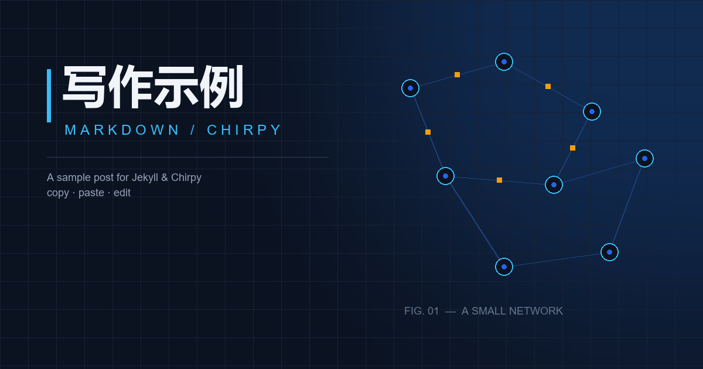
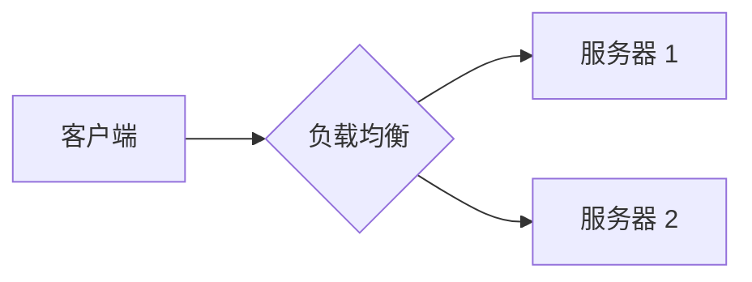

这篇既是文章，也是模板。下面把常用的写法都过一遍，可以整段复制，也可以只挑需要的。

## 标题

### 三级标题

#### 四级标题

##### 五级标题

###### 六级标题

> 正文一般从 `##` 开始，`#` 留给文章标题。

## 文本格式

**加粗**、*斜体*、***加粗斜体***、~~删除线~~、`行内代码`、<mark>高亮</mark>、<kbd>Ctrl</kbd> + <kbd>C</kbd>。

需要原样显示星号时，用反斜杠转义：\*不是斜体\*。

## 链接与脚注

[行内链接](https://jekyllrb.com)、[带标题的链接](https://jekyllrb.com "Jekyll 官网")、<https://github.com/cotes2020/jekyll-theme-chirpy>。

也可以写成引用式链接：[Chirpy 主题][chirpy]。

[chirpy]: https://github.com/cotes2020/jekyll-theme-chirpy

这里有一个脚注[^1]。

[^1]: 脚注会显示在文章底部，适合放补充说明。

## 列表

- 无序列表
  - 嵌套一层
    - 再嵌套一层
- 第二项

1. 有序列表
2. 第二项
   1. 嵌套
   2. 嵌套

- [x] 已完成的待办
- [ ] 未完成的待办

术语
: 定义列表，Kramdown 支持。

## 引用与提示块

> 普通引用。

> 这是一条 tip，适合放小技巧。
{: .prompt-tip }

> 这是一条 info。
{: .prompt-info }

> 这是一条 warning，注意备份。
{: .prompt-warning }

> 这是一条 danger，删库跑路前请三思。
{: .prompt-danger }

## 代码

行内代码：`const answer = 42`。

```c
#include <stdio.h>

int main(void) {
    printf("hello\n");
    return 0;
}
```

```python
def greet(name: str) -> None:
    print(f"hello, {name}")
```

```bash
bundle exec jekyll serve
```

```yaml
title: 文档的写作示例
math: true
mermaid: true
```

## 表格

| 左对齐 | 居中 | 右对齐 |
| :--- | :---: | ---: |
| A | B | C |
| 1 | 2 | 3 |

## 图片


_图片说明：Chirpy 会把图片下方紧挨着的斜体当作 caption。_

{: .w-75 }
_用 Bootstrap 的宽度类可以控制大小，比如 w-50、w-75。_

## 数学

行内公式：$E = mc^2$。

$$
\int_{-\infty}^{\infty} e^{-x^2}\,\mathrm{d}x = \sqrt{\pi}
$$

## Mermaid 图表



## 文件路径

编辑 `_config.yml`{: .filepath }，文章放在 `_posts` 目录里。

## 折叠内容

<details markdown="1">
<summary>点开看更多</summary>

这里可以放任意 Markdown，前后留空行即可。

</details>

## 分隔线

---

## 可选 front matter

```yaml
pin: true                     # 置顶
toc: false                    # 关闭目录
comments: false               # 关闭评论
math: true                    # 启用公式
mermaid: true                 # 启用图表
image: /assets/img/xxx.jpg    # 封面
```

## 最后

上面的写法不用一次全用。日常写作里，标题、列表、代码块、引用和提示块就够用了。
